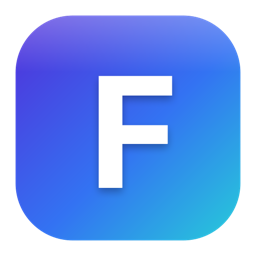

<p align="center">
  
</p>

# Filtered

<p align="center">
  
  
  
  
  
  
  
  
</p>

Fast filtering for images & designs — a native macOS app built with SwiftUI
and Core Image. Made by [@uzerone](https://github.com/uzerone).

> **Status: in development.** Filtered is an early work in progress — things
> are incomplete and may change or break between commits. Not yet recommended
> for production work.

## Features

- **47 filters as layers** — pro adjustments (White Balance,
  Highlights/Shadows, Vibrance, Curves, Noise Reduction), film styles
  (Sepia, Chrome, Fade, Instant, Noir, Tonal, Transfer), and creative
  effects (halftone, mosaic, glass, glitch, ASCII, Kaleidoscope,
  Motion/Zoom Blur, …). Each filter is its own adjustment layer (affects
  everything below it), with per-layer opacity and blend modes
  (Multiply, Screen, Overlay, …).
- **Looks** — one-click editable filter stacks (Newsprint, Riso, VHS,
  Cyberpunk, Golden Hour, Polaroid, …) plus your own saved Looks.
- **Image tools** — non-destructive crop with aspect presets, rotate/flip,
  one-click subject cutout (Vision), live RGB histogram, and a smarter
  Auto Enhance that fixes color casts and recovers shadows/highlights
  with fully editable layers.
- **Text layers** — every macOS font + imported fonts, drag with snapping
  guides.
- **Workflow** — zoom/pan, hold-to-compare (or ⌘\ to toggle),
  drag-drop/paste import, full undo/redo, canvas presets up to 8K,
  `.ftrd` self-contained project files.
- **Export** — PNG/JPEG/TIFF/HEIC, custom size or @1×/@2×/@3× batch,
  metadata + watermark, copy to clipboard.

Previews render at display resolution on a Metal-backed Core Image pipeline
(Swift 6 strict concurrency), so editing stays fast even on 8K canvases.

## Build

Requires macOS 15+ and Xcode 26.

```bash
cd Filtered
xcodebuild -project Filtered.xcodeproj -scheme Filtered \
  -configuration Release -destination 'platform=macOS' build
```

Copy the built `Filtered.app` to `/Applications`.

---

Released under the [MIT License](LICENSE) © 2026 [@uzerone](https://github.com/uzerone).
